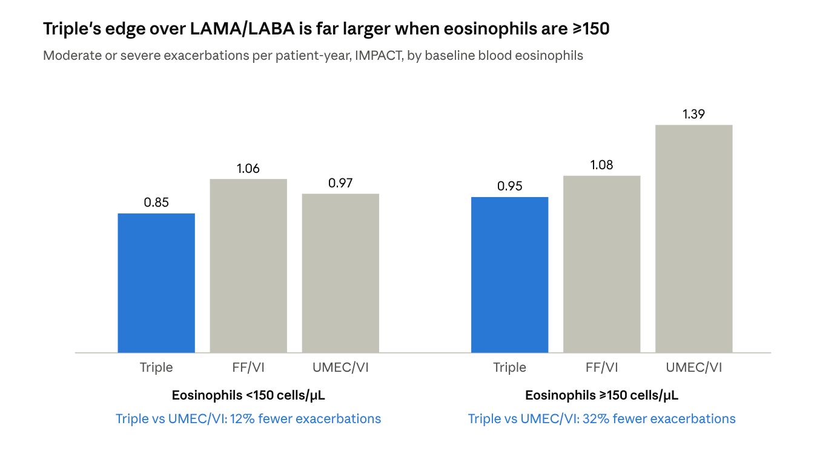

*Lipson et al., N Engl J Med 2018;378:1671-80. Fluticasone furoate/umeclidinium/vilanterol 100/62.5/25 (FF/UMEC/VI) vs FF/VI vs UMEC/VI.*

IMPACT is the trial most often quoted for single-inhaler triple therapy in COPD. I went back to the paper and recalculated the numbers that matter at the bedside: absolute differences, numbers needed to treat, and how fragile the headline findings are.

The verdict first. Triple therapy reduced moderate or severe exacerbations compared with both dual therapies in frequent exacerbators. That result is real and robust. Two parts of how it is usually presented are wrong, though. The headline 25% advantage over LAMA/LABA is very likely inflated by abrupt ICS withdrawal. The mortality claim rests on a single death.

| Claim | Strength | Why |
| --- | --- | --- |
| Triple beats FF/VI (ICS/LABA) on exacerbations | **Proven** | 15% lower (RR 0.85, CI 0.80–0.90). FF/VI patients kept their ICS, so there is no withdrawal problem. The cleanest comparison in the trial. |
| Triple beats UMEC/VI (LAMA/LABA) on exacerbations | **Proven, size overstated** | Direction is certain. The 25% figure includes a withdrawal effect in roughly two-thirds of the UMEC/VI arm. |
| Benefit concentrated in eosinophils ≥150 | Strongly suggested | 32% reduction vs UMEC/VI at ≥150, compared with 12% below 150. Prespecified, but outside the testing hierarchy. |
| Fewer hospitalisations vs UMEC/VI | **Proven** | 34% lower. About 17 patient-years of treatment per hospitalisation avoided. |
| Fewer hospitalisations vs FF/VI | Not shown | RR 0.87, p = 0.06. |
| Triple lowers mortality | **Not proven** | Exploratory outcome, no multiplicity correction. On raw counts the fragility index is 1. |
| Lung function and quality of life better | Statistically yes, clinically marginal | Every between-arm difference falls below its minimal clinically important difference (MCID). |
| Pneumonia risk higher than UMEC/VI | **Proven** | HR 1.53. About 1 extra pneumonia per 29 patient-years. No difference vs FF/VI. |

## Design and population

IMPACT measured what happens when patients already on treatment are switched into one of three regimens. It did not measure what happens when therapy is started fresh. That one design choice drives most of the interpretation.

**Strengths.** The trial is large: 10,355 patients in 37 countries, double-blind, 52 weeks. All three arms used the same molecules in the same Ellipta device, so device and molecule differences cannot explain the results. Exacerbations were captured by e-diary, and deaths were adjudicated by a blinded committee.

**Who was studied.** Patients were 40 or older with a CAT score of 10 or more. They had FEV1 below 50% with at least 1 exacerbation in the past year, or FEV1 50–80% with at least 2 moderate exacerbations or 1 severe one.

| Baseline feature | Value | What it means |
| --- | --- | --- |
| Mean post-bronchodilator FEV1 | 45.5% predicted | Severe disease (GOLD 3) |
| Mean CAT score | 20.1 | High symptom burden |
| Only 1 exacerbation in the prior year | 45% | Almost half were not frequent exacerbators |
| At least 1 severe exacerbation in the prior year | 26% | One in four had been hospitalised |
| Bronchodilator reversibility (≥12% and ≥200 mL) | 18% | Some asthma overlap likely, which favours ICS |
| Eosinophils below 150/µL | 43% | A large low-eosinophil group |
| At least 10 pack-years | 100% (entry rule) | Tobacco COPD only; no biomass COPD |

That last line matters in India, where a large share of COPD comes from biomass smoke rather than cigarettes. IMPACT tells us nothing directly about those patients.

## The ICS-withdrawal problem

Patients stayed on their own medication through a 2-week run-in. At randomisation they switched abruptly, with no washout and no taper.

| Prior therapy at entry | Share | If randomised to UMEC/VI | If randomised to FF/VI | If randomised to triple |
| --- | --- | --- | --- | --- |
| Triple (ICS + LAMA + LABA) | 38% | Lost ICS | Lost LAMA | No change |
| ICS/LABA | 29% | Lost ICS | No change | Gained LAMA |
| LAMA/LABA | 8% | No change | Lost LAMA, gained ICS | Gained ICS |
| Other (monotherapy or none) | about 25% | Varies | Varies | Varies |

My calculation: at least 67% of patients were on an ICS at entry (38% + 29%). In the UMEC/VI arm, about two-thirds therefore had their steroid stopped abruptly on day one. In the FF/VI arm, about 46% lost a LAMA (38% + 8%). The triple arm is the only arm where nobody lost anything.

So IMPACT partly measures the harm of step-down, not only the benefit of step-up. The authors acknowledge this in their discussion and say it is unknown whether it contributed. Their own power assumptions show why it is plausible (see the statistical red flags below).

## Re-calculated efficacy

In absolute terms, about 3 patients must be treated with triple instead of LAMA/LABA for a year to prevent one moderate or severe exacerbation. Against ICS/LABA the figure is about 6. These are good numbers, because COPD exacerbations recur often. The relative percentages simply sound larger than the absolute benefit really is.

Exacerbation outcomes are rates per patient-year, so the NNT below means patient-years of treatment to prevent one event.

| Outcome | Triple | FF/VI | UMEC/VI | Difference vs FF/VI | NNT vs FF/VI | Difference vs UMEC/VI | NNT vs UMEC/VI |
| --- | --- | --- | --- | --- | --- | --- | --- |
| Moderate or severe exacerbations (per year) | 0.91 | 1.07 | 1.21 | 0.16 | 6.3 | 0.30 | 3.3 |
| Severe exacerbations / hospitalisations (per year) | 0.13 | 0.15 | 0.19 | 0.02 (NS) | 50 | 0.06 | 16.7 |
| SGRQ responders, ≥4-point fall | 42% | 34% | 34% | 8 points | 12.5 | 8 points | 12.5 |
| TDI responders, ≥1 unit | 36% | 29% | 30% | 7 points | 14.3 | 6 points | 16.7 |

**Effect size compared with what patients can feel**

| Outcome | Difference vs FF/VI | Difference vs UMEC/VI | MCID | Verdict |
| --- | --- | --- | --- | --- |
| Trough FEV1 | 97 mL | 54 mL | about 100 mL | Just under MCID vs FF/VI, about half of it vs UMEC/VI |
| SGRQ total score | −1.8 | −1.8 | 4 points | Less than half the MCID |

The mean improvement in lung function and quality of life is below the level patients notice. The responder analysis is the fairer clinical lens: about 1 in 12 extra patients gains a meaningful quality-of-life improvement on triple.

The FEV1 pattern is revealing. FF/VI changed by −3 mL from baseline, compared with +40 mL on UMEC/VI and +94 mL on triple. The bronchodilator gain comes from the LAMA. The exacerbation gain over LAMA/LABA comes from the ICS.

## The eosinophil story

Against LAMA/LABA, triple cut exacerbations by 32% when eosinophils were ≥150, but only 12% below 150. The paper's line that benefit appeared "regardless of eosinophil level" is technically true but clinically misleading.

*Source: Lipson et al., NEJM 2018, eosinophil-stratum rates (prespecified, outside the testing hierarchy).*

**My calculations.** Below 150, triple vs UMEC/VI gives a rate ratio of 0.88 and an NNT of 8.3 patient-years. At ≥150, the rate ratio is 0.68 and the NNT is 2.3. The ratio of the two rate ratios is 0.78, a sizeable interaction.

**The hidden finding.** Below 150, ICS/LABA did worse than LAMA/LABA (1.06 vs 0.97). An ICS without a LAMA adds nothing in low-eosinophil patients. At ≥150 the order reverses (FF/VI 1.08 vs UMEC/VI 1.39).

**The withdrawal connection.** The UMEC/VI arm's rate of 1.39 in the ≥150 group is the highest in the trial. Those are exactly the patients most likely to relapse when their ICS is stopped. So the eosinophil effect and the withdrawal effect are tangled together, and IMPACT cannot separate them.

The cut-off of 150 was chosen before GOLD settled on 100 and 300. Strata at those thresholds were reported in later post-hoc analyses, not in this paper.

## The mortality signal

The mortality finding is a hypothesis, not a result. On raw counts, a single death decides whether it is "significant."

| | Triple | FF/VI | UMEC/VI |
| --- | --- | --- | --- |
| Deaths on treatment | 50 / 4,151 (1.20%) | 49 / 4,134 (1.19%) | 39 / 2,070 (1.88%) |
| Reported hazard ratio vs UMEC/VI | 0.58 (0.38–0.88), unadjusted p = 0.01 | 0.61 (0.40–0.93), p = 0.02 | — |

**My recalculation.**

- **Absolute difference.** 1.88% − 1.20% = 0.68%. That is an NNT of about 147 for one year, if the effect were real.
- **Crude test.** A Fisher exact test on raw counts gives p = 0.041 for triple vs UMEC/VI. The authors' HR of 0.58 with p = 0.01 comes from a time-to-event model on on-treatment time, which looks stronger.
- **Fragility index = 1.** Move one death into the triple arm, or remove one from the UMEC/VI arm, and the crude comparison loses significance (p = 0.055).

**Five reasons for caution.**

1. **Hierarchy.** Death was a protocol "other" outcome, not in the testing hierarchy. The paper states that no multiplicity correction was applied.
2. **Few events.** There were only 39 deaths in the comparator arm. The confidence interval runs from 12% to 62% benefit.
3. **ICS is the active ingredient.** FF/VI showed the same apparent benefit (HR 0.61), so any effect belongs to the ICS. The same withdrawal bias then applies: UMEC/VI is the arm where steroids were stopped.
4. **Cause-specific deaths.** Respiratory deaths per 1,000 patient-years were 4.0 (triple), 3.4 (FF/VI) and 5.2 (UMEC/VI). Cardiovascular rates were 4.2, 6.0 and 8.7. There is no plausible mechanism by which an ICS halves cardiovascular death within a year.
5. **SUMMIT disagrees.** SUMMIT was powered for mortality, enrolled more than 16,000 patients and tested FF/VI. It found no significant survival effect. The IMPACT authors themselves call their finding possibly fragile.

A later re-analysis with complete vital-status follow-up (Lipson et al., AJRCCM 2020) reported a smaller but still significant effect. I have not reviewed it here, so check it before quoting.

## Benefit vs harm

Against LAMA/LABA, triple prevents about 6.5 exacerbations for every extra pneumonia it causes. Against ICS/LABA, it prevents exacerbations with no extra pneumonia. For a frequent exacerbator, the trade clearly favours triple.

Per 1,000 patient-years of treatment with triple (event rates from the paper):

| Comparison | Moderate or severe exacerbations prevented | Hospitalisations prevented | Extra pneumonia events | Exacerbations prevented per extra pneumonia |
| --- | --- | --- | --- | --- |
| Triple vs UMEC/VI | 225 | about 60 | 35 | 6.5 |
| Triple vs FF/VI | 129 | about 20 (NS) | −1 (none) | No trade-off |

**Pneumonia, counted per patient.**

| | Triple | FF/VI | UMEC/VI | Triple vs UMEC/VI |
| --- | --- | --- | --- | --- |
| Any pneumonia | 7.6% | 7.1% | 4.7% | +2.9 points, NNH 34 |
| Serious pneumonia | 4.4% | 3.7% | 2.6% | +1.8 points, NNH 55 |

Treat about 34 patients with triple instead of LAMA/LABA for a year and one extra develops pneumonia. Treat about 55 and one extra has a serious pneumonia.

A pneumonia is usually worse than a moderate exacerbation, so the fairer comparison is serious events: about 60 hospitalisations prevented against 18 extra serious pneumonias per 1,000 patients, roughly 3 to 1. The two endpoints can also overlap, because an infective exacerbation with an infiltrate may be labelled pneumonia. Pneumonia counts per patient are not exposure-adjusted, and the dual-therapy arms dropped out more, which slightly overstates triple's excess.

## Statistical red flags

The statistics are competent and pre-registered. Four patterns still tell a careful reader that the 25% headline against LAMA/LABA is partly an artefact of the switch at randomisation.

**1. The comparator did far worse than planned.** The sample-size calculation assumed annual rates of 0.80 (triple), 0.91 (FF/VI) and 0.94 (UMEC/VI).

| Arm | Planned rate | Observed rate | Change |
| --- | --- | --- | --- |
| Triple | 0.80 | 0.91 | +14% |
| FF/VI (kept ICS) | 0.91 | 1.07 | +18% |
| UMEC/VI (most lost ICS) | 0.94 | 1.21 | +29% |

All arms exacerbated more than expected. The arm that had its steroids withdrawn overshot the most. The planned effect vs UMEC/VI was 15% (0.80/0.94); the observed effect was 25%.

**2. Rate ratio vs hazard ratio.** The rate ratio for triple vs UMEC/VI is 0.75, but the hazard ratio for time to first exacerbation is 0.84. Against FF/VI the two match (0.85 and 0.85). When they diverge, the benefit is concentrated in repeat events among a subset of patients, consistent with ICS-withdrawn patients relapsing repeatedly.

**3. Differential dropout.** Treatment was discontinued by 18.3% of the triple arm, 25.2% of FF/VI and 27.3% of UMEC/VI. The primary outcome counted events only while on treatment, so patients who stopped because they did badly took their future exacerbations out of the analysis. The direction of the bias is uncertain, but by week 52 the treated groups were no longer equally randomised.

**4. Overpowered by design.** With 10,355 patients, effects far smaller than any patient would notice reach p < 0.001. The SGRQ differences of −1.8 are an example. In this trial, statistical significance carries almost no information about clinical importance. Read the absolute numbers instead.

**Also note.** The trial was sponsored, designed in partnership with, and lead-authored by GSK, the maker of the product. FF/VI beat UMEC/VI on exacerbations, the opposite of the FLAME trial. The authors attribute this to FLAME's tiotropium run-in, which filtered out ICS-dependent patients. Each trial's design favoured the class it found superior.

## What IMPACT actually tells us

In symptomatic, severe COPD patients who exacerbate, a single once-daily FF/UMEC/VI inhaler cuts exacerbations meaningfully. The gain is largest when eosinophils are 150 or more. The trial also shows that stopping an ICS abruptly in such patients is harmful. The cost is about one extra pneumonia per 30 patient-years compared with LAMA/LABA.

**Who should get triple, according to this evidence**

1. **Already on ICS/LABA and still exacerbating.** Adding the LAMA in one inhaler is the cleanest win in the trial: 15% fewer exacerbations, NNT 6, no extra pneumonia.
2. **On LAMA/LABA, still exacerbating, eosinophils ≥150** (stronger at ≥300). About 2–3 patient-years per exacerbation avoided.
3. **Already on triple and stable.** Do not step down abruptly. The UMEC/VI arm shows what happens.
4. **Low eosinophils (<100), no exacerbations, or past pneumonia.** The benefit is small and the pneumonia cost is real. LAMA/LABA is reasonable here.

## Honest claims, and claims to avoid

For anyone who talks to doctors about triple therapy, this is where IMPACT draws the line.

| Fair to say | Avoid |
| --- | --- |
| "In IMPACT, FF/UMEC/VI reduced moderate or severe exacerbations by 15% vs FF/VI and 25% vs UMEC/VI." | "Triple therapy reduces mortality." |
| "34% fewer COPD hospitalisations vs UMEC/VI." | "Fewer hospitalisations than ICS/LABA" (not significant). |
| "Greater benefit in patients with eosinophils ≥150." | "Works equally regardless of eosinophils." |
| "Once-daily single-inhaler triple therapy." | "Improves quality of life" without the responder rate (42% vs 34%). |
| "Pneumonia was more frequent in ICS-containing arms; select patients accordingly." | Any claim that hides the pneumonia signal. |

*Disclosure: my company, Bayu Healthcare, markets respiratory inhalers, including triple therapy. IMPACT used GSK's Ellipta product; I discuss it here as evidence for the molecule combination, and I wrote this appraisal partly to keep our own claims honest.*

See also: [FULFIL, recalculated](fulfil-recalculated), the companion appraisal of triple therapy against ICS/LABA.

## Source

Lipson DA et al. Once-Daily Single-Inhaler Triple versus Dual Therapy in Patients with COPD (IMPACT). N Engl J Med 2018;378:1671-80. Recalculations, NNTs and fragility estimates are my own, from the figures reported in the paper.
